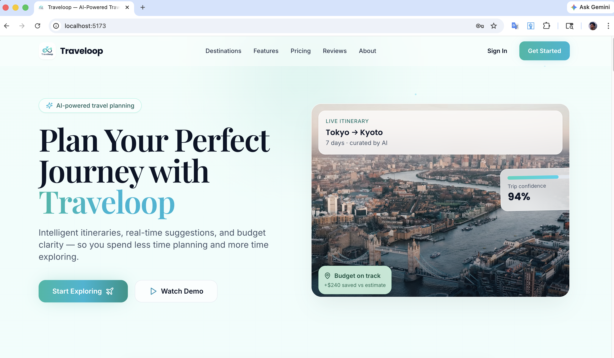
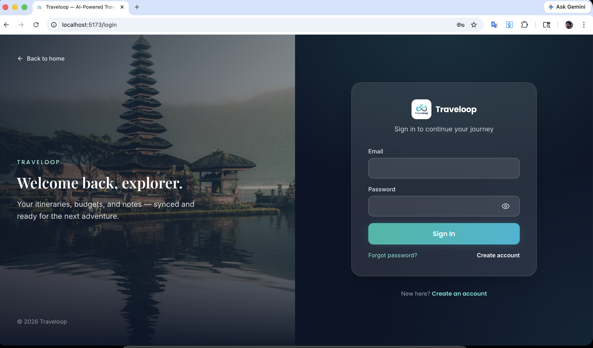
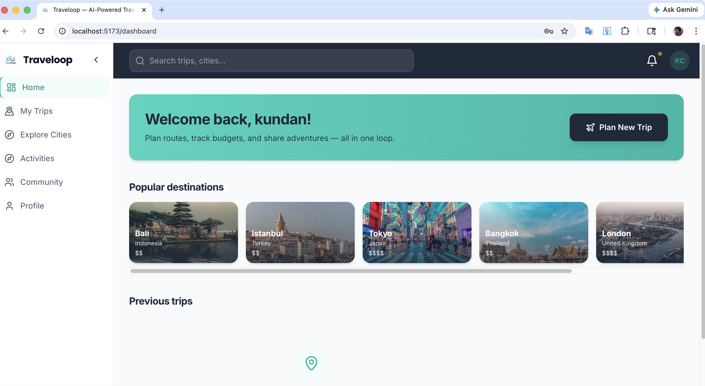
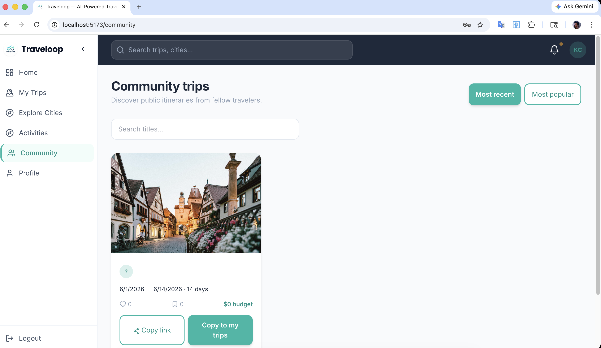
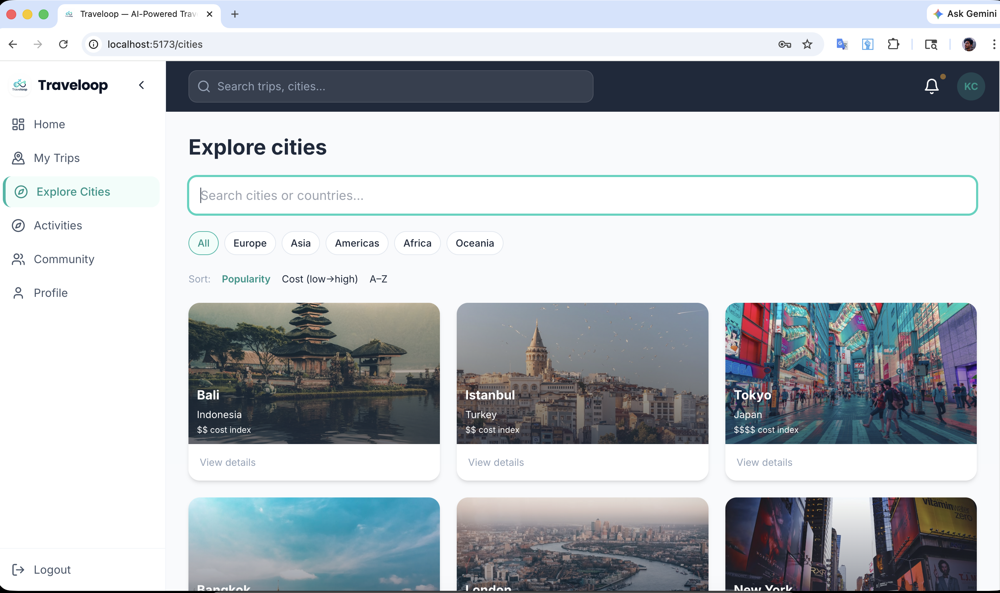

<div align="center">

# 🌍 Colombiator

### **AI-Powered Travel Planning, Collaborative Itineraries & Smart Budgeting**
*Built for the Odoo x Parul University Hackathon 2026*

[](https://colombiator.vercel.app/)
[](https://reactjs.org/)
[](https://nodejs.org/)
[](https://www.mongodb.com/)
[](https://tailwindcss.com/)

---

> **Plan routes, track budgets, and share adventures — all in one loop.**

**Colombiator** transforms fragmented travel planning into a seamless, intelligent loop. From discovering curated destinations and building customized multi-stop itineraries to tracking budgets in real time and sharing journeys with a global community, Colombiator is your all-in-one travel companion.

**Production URL:** [https://colombiator.vercel.app/](https://colombiator.vercel.app/)

</div>

---

## 📑 Table of Contents

- [Visual Showcase & Page Walkthrough](#-visual-showcase--page-walkthrough)
- [Page Flow Architecture](#-page-flow-architecture)
- [Key Features](#-key-features)
- [Complete User Guide](#-complete-user-guide)
- [Technology Stack](#-technology-stack)
- [Project Architecture](#-project-architecture)
- [Legal & Trust Center (DPDPA 2023 & GDPR)](#-legal--trust-center-dpdpa-2023--gdpr)
- [Local Development Setup](#-local-development-setup)
- [Database Seeding](#-database-seeding)
- [Deploying on Vercel](#-deploying-on-vercel)
- [API Reference](#-api-reference)
- [Security & Best Practices](#-security--best-practices)

---

## 📸 Visual Showcase & Page Walkthrough

### 1. 🏠 Landing Page — Hero Section
**URL:** `/` *(https://colombiator.vercel.app/)*



The public-facing homepage introduces Colombiator with a bold headline and a live itinerary preview widget showing real-time budget tracking and AI confidence scores.
- **Hero Headline:** *"Plan Your Perfect Journey with Colombiator"*
- **Live Demo Card:** Curated route (e.g., Tokyo → Kyoto, 7 days, 94% confidence, budget pulse)
- **Direct Calls-to-Action:** **Start Exploring** and **Watch Demo**
- **Top Navigation:** Destinations, Features, Pricing, Reviews, About, Sign In, Get Started

---

### 2. 🔐 Login Page
**URL:** `/login`



Split-screen layout with responsive authentication:
- **Left:** Full-bleed destination photo (Bali temple) with tagline: *"Welcome back, explorer."*
- **Right (glassmorphic card):** Email & Password fields, Show/Hide password toggle, Sign In action, Forgot Password, and Create Account links

---

### 3. 📝 Signup Page
**URL:** `/signup`


Streamlined traveler registration with instant validation:
- **Left:** Tokyo neon street scene with quote: *"The world is wide — your plan should be too."*
- **Right (glassmorphic card):** First Name, Last Name, Email, Phone Number, City, Country selector, Password, and Additional Information fields

---

### 4. 📊 Dashboard (Home — After Login)
**URL:** `/dashboard`



The main personal hub after authentication:
- **Personalized Greeting:** *"Welcome back, [username]!"* with **Plan New Trip** CTA
- **Popular Destinations Carousel:** Horizontal scrollable cards (Bali, Istanbul, Tokyo, Bangkok, London) with cost index ratings (`$$`–`$$$$`)
- **Previous Trips:** Active and completed journey tracking
- **Sidebar Navigation:** Home, My Trips, Explore Cities, Activities, Community, Profile

---

### 5. 👥 Community Itineraries
**URL:** `/community`



Discover and share public itineraries with the global traveler community:
- **Section Title:** *"Community trips — Discover public itineraries from fellow travelers."*
- **Toggles & Search:** Filter by **Most Recent** or **Most Popular**; instant search across trip titles
- **Trip Cards:** Destination cover photos, dates, duration, budget indicators, and likes/saves
- **Social Actions:** **Copy link** for instant sharing, **Copy to my trips** to clone any public route into your own planner

---

### 6. 🌍 Explore Cities Page
**URL:** `/cities`



Browse and discover worldwide destinations with live filtering:
- **Instant Search:** Search across cities and countries in real time
- **Continent Filters:** All, Europe, Asia, Americas, Africa, Oceania
- **Sorting Options:** Popularity, Cost (low→high), Alphabetical (A–Z)
- **Destination Cards:** 3-column responsive grid with city photo, country, cost index, and **View details** link

---

## 🧭 Page Flow Architecture

```
Landing Page (/)
    ├── Features & Destinations (scroll)
    ├── Sign In → /login
    └── Get Started → /signup

Authenticated App:
    /dashboard (Personalized Hub)
        ├── /trips/new    → Plan New Trip & City Selector Modal
        ├── /trips        → My Trips & Itinerary Viewer
        ├── /cities       → Explore Cities & Curated Activities
        ├── /activities   → Browse Experiences
        ├── /community    → Public Itineraries & Trip Cloning
        └── /profile      → User Profile & Saved Destinations
```

---

## 🚀 Key Features

- **⚡ AI & Intelligent Route Planning**: Curate multi-day, multi-stop itineraries with day-by-day activity suggestions tailored to your schedule.
- **🧭 Dynamic City Exploration**: Search and filter global destinations by region (Europe, Asia, Americas, Africa, Oceania) with live cost ratings and popularity metrics.
- **💰 Smart Budget Pulse**: Track accommodation, transport, meals, activities, and miscellaneous expenses against planned thresholds in real time.
- **🗺️ Interactive Map Views**: Visualize travel stops and waypoints powered by Leaflet & React-Leaflet.
- **👥 Community & Public Sharing**: Publish trips with unique shareable links; clone community trips into your private itinerary in one click.
- **🧳 Packing Checklists & Trip Notes**: Keep packing items organized by category and store crucial travel notes offline-first.
- **🔔 Real-Time Notification Center**: Interactive alerts for community interactions, trip reminders, and status updates.
- **☁️ Cloud-Ready & Serverless Architecture**: Fully optimized for Vercel Serverless Functions with MongoDB Atlas connection pooling and fallback handling.

---

## 📖 Complete User Guide

### Step 1: Getting Started & Registration
1. Navigate to the **Sign Up** page (`/signup`).
2. Fill in your details (Full Name, Email, Password, Country, City).
3. Upon registration, you are automatically signed in with a secure session cookie and directed to your **Dashboard**.
4. Existing users can log in from the **Sign In** page (`/login`).

### Step 2: Exploring Destinations
1. Open the **Explore Cities** tab from the sidebar (`/cities`).
2. Filter cities by region using the pills (*All*, *Europe*, *Asia*, *Americas*, *Africa*, *Oceania*).
3. Sort results by *Popularity*, *Cost (Low to High)*, or alphabetically (*A–Z*).
4. Click **View details** on any destination card to see curated activities, average costs, and local highlights.

### Step 3: Creating a New Trip
1. From the Dashboard or My Trips page, click **Plan New Trip** (`/trips/new`).
2. Enter your **Trip Name** and trip dates using the interactive date pickers.
3. Select your **Destination City** using the integrated destination search modal.
4. Upload a custom cover photo (stored securely in Cloudinary or local/serverless fallback) or let the destination's cover image auto-populate.
5. Choose whether to make the trip **Public** for the community or keep it **Private**.
6. Click **Save & Continue to Itinerary** to enter the Itinerary Builder.

### Step 4: Building & Customizing Itineraries
1. In the **Itinerary Builder** (`/trips/:id/builder`), view your stops organized chronologically.
2. Add new stops, browse suggested city activities, and attach activities to specific days.
3. Switch between **List View** and **Interactive Map View** to preview your travel route.

### Step 5: Managing Trip Budgets
1. Navigate to **Budget** (`/trips/:id/budget`).
2. Allocate funds across categories:
   - 🏨 Accommodation
   - ✈️ Transportation
   - 🍽️ Food & Dining
   - 🎟️ Activities & Attractions
   - 🛍️ Miscellaneous
3. Monitor your **Budget Pulse** on the dashboard to ensure your spending stays on track.

### Step 6: Community Sharing
1. Visit the **Community** tab (`/community`).
2. Explore public trips shared by other explorers.
3. Click **Copy link** to share a direct read-only itinerary link with friends.
4. Click **Copy to my trips** to clone any community itinerary directly into your account and customize it.

---

## 🛠 Technology Stack

### Frontend
- **Framework**: [React 18](https://react.dev/)
- **Bundler**: [Vite 5](https://vitejs.dev/)
- **Routing**: [React Router DOM v6](https://reactrouter.com/)
- **State & Data Fetching**: [TanStack React Query v5](https://tanstack.com/query)
- **Styling**: [Tailwind CSS v3](https://tailwindcss.com/)
- **Animations**: [Framer Motion](https://www.framer.com/motion/)
- **Icons**: [Lucide React](https://lucide.dev/)
- **Maps**: [Leaflet](https://leafletjs.com/) & [React-Leaflet](https://react-leaflet.js.org/)
- **Date Pickers & Charts**: `react-datepicker`, `recharts`

### Backend
- **Runtime**: [Node.js (ES Modules)](https://nodejs.org/)
- **Framework**: [Express.js v4](https://expressjs.com/)
- **Serverless Adapter**: Native Vercel Serverless Function entry point (`api/index.js`)
- **Authentication**: JSON Web Tokens (`jsonwebtoken`) + `bcryptjs` password hashing + HTTP-only cookies
- **Security**: `helmet`, `cors`, `express-rate-limit`
- **File Uploads**: `multer` with Cloudinary CDN integration and base64 fallback

### Database & Cloud
- **Database**: [MongoDB Atlas](https://www.mongodb.com/atlas) with [Mongoose v8](https://mongoosejs.com/)
- **Hosting**: [Vercel](https://vercel.com/) (Edge Static Hosting + Serverless Functions)
- **Media**: [Cloudinary](https://cloudinary.com/) (with local disk & Data URI resilience)

---

## 🏛 Project Architecture

```
colombiator/
├── .github/                 # GitHub Actions CI automated workflows
├── client/                  # Frontend Single Page Application (React + Vite)
│   ├── public/              # Static assets (logo.png, favicon.svg, robots.txt, sitemap.xml)
│   ├── src/
│   │   ├── components/      # UI components (auth, dashboard, itinerary, layout, legal)
│   │   │   ├── common/      # CookieBanner, Footer, Navbar, Modal
│   │   │   └── legal/       # LegalLayout, shared trust UI
│   │   ├── context/         # AuthContext & global state
│   │   ├── pages/           # Application views (Dashboard, Cities, Trips, Community)
│   │   │   └── legal/       # Privacy, Terms, Cookie, DPDPA, Data Deletion, Acceptable Use, Contact
│   │   ├── services/        # Axios API clients
│   │   └── utils/           # Helper functions & constants
│   ├── package.json
│   └── vite.config.js
├── server/                  # Backend REST API (Express.js)
│   ├── config/              # MongoDB connection, envCheck, Cloudinary config
│   ├── controllers/         # Business logic for all API endpoints (auth, trips, contact, etc.)
│   ├── middleware/          # JWT protect, upload, errorHandler, rateLimiters
│   ├── models/              # Mongoose schemas (User, Trip, City, Activity, Stop, Budget)
│   ├── routes/              # Express route declarations (including /api/contact)
│   ├── tests/               # Automated unit, integration, and security tests (Jest + Supertest)
│   ├── utils/               # Seed data & JWT generator
│   ├── dist/                # Pre-bundled production server for Vercel service runtime
│   ├── package.json
│   └── server.js            # Express app configuration & middleware
├── screenshots/             # Production application screenshots
├── .env.example             # Safe placeholder template for environment variables
├── package.json             # Root unified package configuration
├── vercel.json              # Vercel multi-service deployment & rewrite configuration
└── README.md                # Project documentation & user guide
```

---

## 📜 Legal & Trust Center (DPDPA 2023 & GDPR)

Colombiator is built on strict transparency, digital privacy, and ethical open access for travelers worldwide:

- **Indian Digital Personal Data Protection Act (DPDPA 2023) Compliance**: Explicit data principal rights, purpose limitation, and statutory Grievance Redressal mechanism.
- **GDPR & International Privacy Alignment**: Data portability, clear subprocessors disclosure (Vercel, MongoDB Atlas, Cloudinary), and zero non-essential cookie tracking without consent.
- **Self-Service & Assisted Data Deletion (`/data-deletion`)**: One-click complete account and itinerary eradication via `/profile` (Danger Zone) with automated cascade deletion.
- **Interactive Cookie Consent System**: Granular preference controls (Essential, Analytics, Functional) persistent across sessions, with instant reset via the footer anytime.
- **Truth in Advertising**: 100% Free Open Access Hackathon Edition. No fake ratings, no artificial tiers, and no fabricated reviews.

### Legal Routes Directory:
| Canonical Route | Document Title | Description & Compliance Scope |
| :--- | :--- | :--- |
| [`/legal`](https://colombiator.vercel.app/legal) | **Trust & Legal Center** | Central gateway to all governance, security, and privacy documents |
| [`/privacy-policy`](https://colombiator.vercel.app/privacy-policy) | **Privacy Policy** | Comprehensive DPDPA 2023 & GDPR disclosure, subprocessor list, data rights |
| [`/terms-of-service`](https://colombiator.vercel.app/terms-of-service) | **Terms of Service** | Fair use, user content ownership, hackathon access terms, jurisdiction |
| [`/cookie-policy`](https://colombiator.vercel.app/cookie-policy) | **Cookie Policy** | Transparent inventory of local storage keys and interactive consent changer |
| [`/acceptable-use`](https://colombiator.vercel.app/acceptable-use) | **Acceptable Use Policy** | Content standards, prohibited actions, security scanning boundaries |
| [`/data-deletion`](https://colombiator.vercel.app/data-deletion) | **Data Deletion Instructions** | Step-by-step account removal, database cascade details, and offline request flow |
| [`/community-guidelines`](https://colombiator.vercel.app/community-guidelines) | **Community Guidelines** | Responsible route sharing, leave-no-trace ethics, safe itinerary cloning |
| [`/security`](https://colombiator.vercel.app/security) | **Security Center** | Encryption standards, password hashing, vulnerability disclosure policy |
| [`/contact`](https://colombiator.vercel.app/contact) & [`/help`](https://colombiator.vercel.app/help) | **Contact & Support** | Live rate-limited support form and direct officer contact channels |

---

## 💻 Local Development Setup

### Prerequisites
- **Node.js**: v18.0.0 or higher (v20+ recommended)
- **npm**: v9.0.0 or higher
- **MongoDB Atlas** account or local MongoDB instance

### 1. Clone the Repository
```bash
git clone https://github.com/mahfooz091/OdooxParulUniversityHackathon26.git
cd OdooxParulUniversityHackathon26
```

### 2. Configure Environment Variables
Create a `.env` file inside the `server/` directory:
```bash
cp server/.env.example server/.env
```
Fill in your configuration:
```env
PORT=5001
MONGO_URI=mongodb+srv://<username>:<password>@cluster0.xxxxx.mongodb.net/colombiator?retryWrites=true&w=majority
JWT_SECRET=your_super_secret_jwt_key_at_least_32_chars
JWT_EXPIRE=30d
CLIENT_URL=http://localhost:5173
NODE_ENV=development
```

*(Optional) Create `client/.env` if you need custom API URLs:*
```env
VITE_API_URL=http://localhost:5001/api
```

### 3. Install Dependencies
```bash
# Install backend dependencies
cd server && npm install

# Install frontend dependencies
cd ../client && npm install
```

### 4. Seed the Database
Populate the database with curated cities, activities, demo users, and starter itineraries:
```bash
cd ../server
node utils/seedData.js
```

### 5. Start Development Servers
Open two terminal windows:

**Terminal 1 (Backend API):**
```bash
cd server
npm run dev
# Server runs on http://localhost:5001
```

**Terminal 2 (Frontend Client):**
```bash
cd client
npm run dev
# Frontend runs on http://localhost:5173
```

Visit **`http://localhost:5173`** in your browser.

---

## 🚀 Deploying on Vercel

This repository is configured for a **unified fullstack deployment** on Vercel:
- The React frontend is built and served via Vercel's global CDN.
- The Express backend runs as a high-performance **Vercel Serverless Function** via `api/index.js`.
- All `/api/*` requests route internally to the serverless function on the same domain (no CORS friction or cookie blockage).

### Step-by-Step Vercel Deployment

1. **Push your code to GitHub**:
   Ensure all changes are pushed to your repository `https://github.com/mahfooz091/OdooxParulUniversityHackathon26`.

2. **Import into Vercel**:
   - Go to [vercel.com](https://vercel.com/) and click **Add New...** -> **Project**.
   - Select your repository **`OdooxParulUniversityHackathon26`**.

3. **Configure Project Settings**:
   - **Framework Preset**: `Other` (or leave default Vite/auto-detected).
   - **Root Directory**: `./` (leave as Root).
   - **Build Command**: `cd client && npm install && npm run build` *(configured in `vercel.json`)*.
   - **Output Directory**: `client/dist` *(configured in `vercel.json`)*.

4. **Add Environment Variables**:
   In Vercel **Project Settings -> Environment Variables**, add:

   | Key | Recommended Value | Description |
   | :--- | :--- | :--- |
   | `MONGO_URI` | `mongodb+srv://...` | MongoDB Atlas connection string |
   | `JWT_SECRET` | *(Random 32+ character string)* | Secret for signing JWT authentication tokens |
   | `JWT_EXPIRE` | `30d` | JWT expiration duration |
   | `NODE_ENV` | `production` | Environment mode |
   | `CLOUDINARY_CLOUD_NAME` | *(Optional)* | Cloudinary cloud name for persistent media uploads |
   | `CLOUDINARY_API_KEY` | *(Optional)* | Cloudinary API Key |
   | `CLOUDINARY_API_SECRET` | *(Optional)* | Cloudinary API Secret |

5. **MongoDB Network Access Whitelist**:
   - In MongoDB Atlas, navigate to **Security** -> **Network Access**.
   - Click **Add IP Address** -> **Allow Access From Anywhere** (`0.0.0.0/0`) so that Vercel's dynamic serverless IP ranges can reach your database.

6. **Deploy**:
   - Click **Deploy**.
   - Vercel will install dependencies, build the frontend bundle, package the serverless function, and provide your public production URL (e.g., `https://colombiator.vercel.app`).

---

## 📡 API Reference

All backend routes are accessible under `/api`:

| Method | Endpoint | Access | Description |
| :--- | :--- | :--- | :--- |
| `GET` | `/api/health` | Public | System health check |
| `POST` | `/api/auth/register` | Public | Register a new user |
| `POST` | `/api/auth/login` | Public | Authenticate user & receive token |
| `POST` | `/api/auth/logout` | Public | Clear session cookie |
| `GET` | `/api/auth/me` | Private | Get current authenticated profile |
| `GET` | `/api/cities` | Public | List cities with search & pagination |
| `GET` | `/api/cities/popular` | Public | Fetch top popular cities for homepage |
| `GET` | `/api/cities/:id` | Public | Get single city details & coordinates |
| `GET` | `/api/activities` | Public | Search curated activities by city |
| `GET` | `/api/trips` | Private | Get current user's trips |
| `POST` | `/api/trips` | Private | Create a new trip |
| `GET` | `/api/trips/:id` | Private | Retrieve trip by ID with stops & budget |
| `PUT` | `/api/trips/:id` | Private | Update trip details |
| `DELETE` | `/api/trips/:id` | Private | Delete a trip |
| `GET` | `/api/community` | Public | Fetch published community trips |
| `POST` | `/api/community/:id/clone` | Private | Clone a public community trip into your trips |
| `POST` | `/api/upload` | Private | Upload image (Cloudinary / Data URI fallback) |
| `POST` | `/api/contact` | Public | Submit contact / support message (rate-limited) |
| `DELETE` | `/api/users/profile` | Private | Delete account & cascade delete all personal itineraries |

---

## 🔒 Security & Best Practices

- **Zero Hardcoded Secrets**: All credentials (`MONGO_URI`, `JWT_SECRET`, API keys) are strictly managed via environment variables and excluded from version control.
- **HTTP-Only Cookies & Bearer Tokens**: Session tokens are guarded against XSS via `httpOnly` flags with automatic `Bearer` header fallback.
- **Helmet Protection**: Security headers (`X-Frame-Options`, `X-Content-Type-Options`, `Cross-Origin-Resource-Policy`) are enforced across all responses.
- **Input Sanitization**: Password hashing with `bcryptjs` salt rounds and strict Mongoose schema validation.
- **Connection Caching**: Mongoose connections in serverless functions reuse existing connections across invocations to avoid connection saturation.

---

<div align="center">
  <p>© 2026 Colombiator. Built with ❤️ for <b>Odoo x Parul University Hackathon 2026</b></p>
</div>
